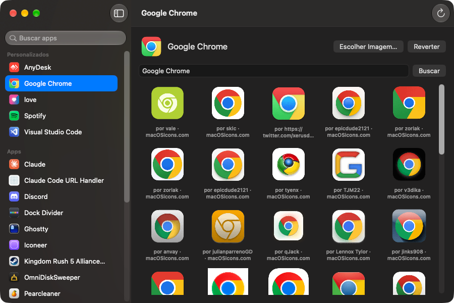

# Iconeer

A macOS menu bar app that changes the icons of your apps with icons from [macOSicons.com](https://macosicons.com), or with any PNG or ICNS file, and puts them back after the apps update themselves.



The new icon is set on the app itself, not on the Dock, so it shows in Finder and in the Dock alike. Iconeer writes it the same way Finder's Get Info does, as an `Icon\r` file at the root of the app bundle; nothing inside `Contents/` changes, so the app's code signature stays valid.

## Requirements

- macOS 26 or later
- The **App Management** permission, to change other apps: macOS asks for it the first time, or turn on Iconeer in **System Settings → Privacy & Security → App Management**.
- A macOSicons API key, to search the catalog. Create one at [macosicons.com/developers](https://macosicons.com/developers); the free plan includes 50 requests a month. Iconeer keeps the key in your Keychain. Applying an icon from a file needs no key.

## What it can't change

- **Apple's apps** (Safari, Finder, System Settings, and the rest of `/System/Applications`): macOS protects them unless System Integrity Protection is turned off.
- **Apps installed from the App Store**: macOS refuses writes to their bundles, even from an administrator or from Finder.
- **Apps you don't have write permission for**, such as some apps installed by a `.pkg` as root.

Iconeer marks these apps in the list and does not try to change them.

## Install

Paste this in Terminal:

```sh
curl -fsSL https://raw.githubusercontent.com/luantedesco/iconeer/main/Tools/install.sh | sh
```

It downloads the latest release, installs it in `/Applications`, and opens it. Run it again to update.

### Manual install

Download `Iconeer.dmg` from the [latest release](https://github.com/luantedesco/iconeer/releases/latest), open it, and drag `Iconeer.app` to `Applications`.

The app is not notarized by Apple, so macOS blocks it on first launch. Try to open it, then go to **System Settings → Privacy & Security** and click **Open Anyway**. Or remove the quarantine flag from the terminal:

```sh
xattr -dr com.apple.quarantine "/Applications/Iconeer.app"
```

## Usage

1. Open Iconeer and select an app. The sidebar groups your apps into **Customized**, **Apps** and **Can't Change**; type in **Search apps** to filter them by name. **Refresh** (⌘R) scans the app folders again.
2. Use **Choose Image…** to apply a PNG or ICNS file from your Mac. This needs no API key.
3. To use the macOSicons catalog, open **Settings** (⌘,) and paste your key; Iconeer also opens Settings on your first search without one. **Clear** removes the key from your Keychain. The search is filled in with the app's name; edit it if needed, and click **Search**. **Load More** brings the next page of results. Click an icon to apply it.
4. **Revert** puts the original icon back.

If the app is open, the Dock keeps its old icon until the app quits; Iconeer tells you when that is the case. Otherwise it restarts the Dock (`killall Dock`) so the new icon shows right away.

Iconeer lives only in the menu bar: it never shows in the Dock or Cmd+Tab, and it starts without opening a window. Choose **Open Iconeer** in the menu bar icon to open it; closing the window keeps Iconeer running. While it runs, it checks every 30 seconds for apps whose custom icon was removed by an update, and puts it back. It also checks when it opens, for updates that happened while it was closed. If an icon can't be restored, Iconeer sends a notification once. macOS adds Iconeer to **System Settings → Notifications** with notifications turned off; turn them on there to get these alerts. Turn on **Open at Login** in the menu bar icon to have Iconeer start with your Mac, so it keeps putting icons back after a restart.

Searches are cached for 30 days, so repeating one does not use your monthly quota.

## Data

Iconeer keeps its data in `~/Library/Application Support/Iconeer/`: the list of customized apps, a copy of each applied image (used to restore it after updates), and the search cache.

## Terms

Icons from macOSicons.com remain the property of their creators. Iconeer shows each creator's credit and macOSicons.com as the source, and applies icons for your personal customization only.

## Uninstall

1. Revert the apps you customized, if you want their original icons back.
2. Turn off **Open at Login** in the menu bar icon, then choose **Quit**.
3. Move `Iconeer.app` to the Trash and delete `~/Library/Application Support/Iconeer/`.
4. Delete the "Iconeer" item from Keychain Access.

## Build

```sh
./build.sh
```

The app is built at `build/Iconeer.app` as a universal binary (Apple Silicon and Intel). Move it to `/Applications` and open it.

To package it as a disk image for distribution:

```sh
./Tools/make-dmg.sh
```

The image is created at `build/Iconeer.dmg`.

To run the tests:

```sh
swift test
```

The app icon is drawn in `Resources/icon.svg`. `build.sh` turns it into `AppIcon.icns` on every build, so editing the SVG and rebuilding is enough.

## Contributing

Bug reports, ideas, and pull requests are welcome. [CONTRIBUTING.md](CONTRIBUTING.md) covers building, testing, and the signing certificate that keeps the App Management permission across builds.

## Translations

Iconeer is available in English and Brazilian Portuguese. To add a language, see [Translations](CONTRIBUTING.md#translations) in CONTRIBUTING.md.

## License

[MIT](LICENSE). The icons from macOSicons.com are not covered by this license; see [Terms](#terms).
